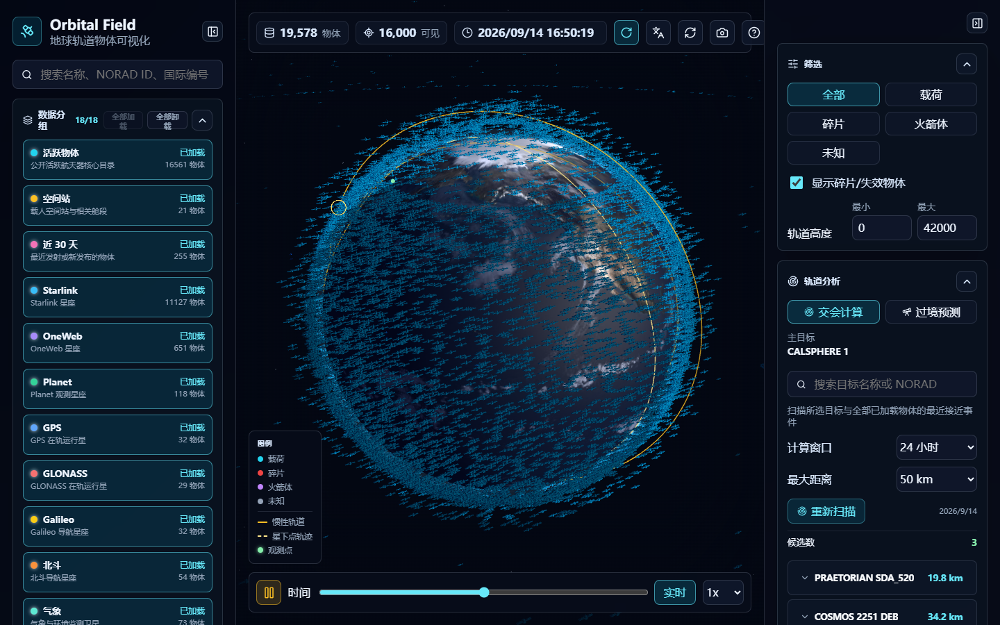

<p align="center">
  
</p>

<h1 align="center">🛰️ Orbital Field · 轨道场</h1>

> **Hosted version / 托管版本：** [Orbital Field · 轨道场](https://orbital-field.zzyyss298.chatgpt.site) — maintained as a separate Sites project; this repository neither contains its source nor deploys it. 托管版由独立的 Sites 项目维护，本仓库不包含其源码，也不会自动更新或部署它。发布记录见 [公开发布记录](docs/sites-publication.md)。

<p align="center">
  <strong>A real-time 3D tracker for 16,000+ satellites, debris, and rocket bodies — live CelesTrak data, rendered in the browser.</strong>
</p>

<p align="center">
  <a href="https://github.com/zhang-forever/3d_satelite_explorer/stargazers"></a>
  <a href="https://github.com/zhang-forever/3d_satelite_explorer/network"></a>
  <a href="https://github.com/zhang-forever/3d_satelite_explorer/issues"></a>
  <a href="LICENSE"></a>
  <br>
  <a href="https://nextjs.org"></a>
  <a href="https://react.dev"></a>
  <a href="https://www.typescriptlang.org"></a>
  <a href="https://threejs.org"></a>
</p>

<p align="center">
  <a href="#-english">English</a> · <a href="#-中文">中文</a> · <a href="#getting-started">Getting Started</a> · <a href="#features">Features</a>
</p>

> ⚠️ **For visualization and education only.** Orbits use SGP4 from public TLE/OMM data and are **not** suitable for operational collision avoidance.
>
> ⚠️ **仅用于可视化与教学。** 轨道由公开 TLE/OMM 数据经 SGP4 计算得到，**不可**用于实际的碰撞规避决策。

---

## 🇬🇧 English

### Features

**🌍 3D Globe (Three.js)**
- Textured Earth with normal and specular maps, drifting clouds, atmospheric glow, and a procedural starfield.
- Instanced rendering for up to **16,000** objects, with a distinct mesh per class: payload (bus, solar panels, dish), rocket body (cylinder with nose cone), debris (irregular tetrahedron), and unknown (sphere).
- **Eclipse shading** dims objects inside Earth's shadow, and a day/night terminator great circle is drawn from the Sun's sub-solar point.
- Click any object to select it (GPU raycasting). The camera auto-rotates with damped `OrbitControls`.
- The selected object gets an inertial **orbit track**, a **ground track**, a **footprint** coverage circle, and a highlight ring.

**📡 Live Data & Catalogs**
- 18 color-coded CelesTrak groups: Active, Stations, Last 30 days, Starlink, OneWeb, Planet, GPS, GLONASS, Galileo, BeiDou, Weather, Science, GEO, three debris clouds (COSMOS 2251 / IRIDIUM 33 / Fengyun-1C), Potential Decays, and the GEO Protected Zone.
- Only Active loads at startup; the rest load and unload on demand and are merged into a single propagation set.
- **Server-side cache** (`.cache/celestrak`, overridable with `CELESTRAK_CACHE_DIR`, 4-hour TTL) with conditional requests, request coalescing, atomic writes, and stale-on-error fallback. Repeated source errors trigger persistent cooldowns; HTTP 403/404 responses stop automatic downloads until the issue is reviewed.

**⏱️ Propagation & Time**
- SGP4 via [`satellite.js`](https://github.com/shashwatak/satellite-js), running in a **Web Worker** so propagation stays off the UI thread. Frame rate depends on the device and the number of loaded objects.
- Time controls: play/pause, speed multipliers (0× / 1× / 10× / 60× / 600×), a −24 h…+24 h scrub slider, and a "live" reset.

**🔍 Filters**
- Free-text search over name / NORAD ID / international designator.
- Class filter (all / payload / debris / rocket / unknown), a debris toggle, and a min–max altitude band.

**🛸 Orbit Analysis**
- **Rendezvous scan** — compares the selected primary against every loaded object and reports close approaches within a chosen window (6–72 h) and miss distance (5–200 km): time of closest approach, miss distance, relative speed, current separation, and sub-point.
- **Pass prediction** — visible passes over an observer (manual lat/lon or browser geolocation) in the next 48 h, filtered by minimum elevation, with rise/set azimuths, peak elevation, and duration.

**✨ Quality-of-life**
- **Watchlist** — starred objects, persisted in `localStorage`.
- **Export** — selected object's OMM record as JSON.
- Bilingual UI (中文 / English), auto-detected from browser, toggleable.
- Collapsible side rails and panels.

### ⚡ Performance

The scene updates once per second with up to 16k objects on screen. The hot paths minimize per-object allocation and keep expensive work off the UI thread:

- **Struct-of-arrays propagation.** The worker writes into reusable
  `Float32Array` buffers (`propagateBatch`) and posts one flat snapshot per
  update instead of allocating 16,000 objects; the main thread patches a pool
  of plain objects in place. Typed-array snapshots still incur copying and
  allocation at the thread boundary.
- **Decoupled analysis cadence.** The 48 h pass list is recomputed at most once
  a minute, and the orbit track every 5 s, rather than on every tick. The
  rendezvous sweep runs when the selection or settings change (or on <kbd>S</kbd>
  / Rescan) and reports progress instead of restarting every second.
- **A separate thread for scans.** A full 16k-object close-approach sweep takes
  seconds, so it runs on a second worker and never stalls the globe.
- **Deterministic de-duplication.** Objects listed in several catalogs
  (Starlink is also "active") are propagated and drawn once, keyed by NORAD id.
- **Cheaper per-frame work.** Cached `Intl` formatters, identity-seeded
  instance matrices written as three floats, O(1) hit-testing, no
  `preserveDrawingBuffer`, and instance buffers that start small and grow.

### Tech Stack

| Layer | Choice |
|---|---|
| Framework | Next.js (App Router, React 19) |
| Language | TypeScript |
| 3D | Three.js (`InstancedMesh`, `OrbitControls`) |
| Orbital mechanics | `satellite.js` (SGP4 / OMM) |
| Icons | `lucide-react` |
| Data source | [CelesTrak GP](https://celestrak.org/NORAD/elements/) (OMM JSON) |
| Tests | Vitest + Testing Library + jsdom |

### Getting Started

**Prerequisites:** Node.js **22.12+ (22.x)** or **24.x**. Runtime internet access is required for the CelesTrak GP API; Earth textures ship locally under `public/textures/`.

```bash
# install dependencies
npm ci

# start the dev server
npm run dev

# open http://localhost:3000
```

No environment variables or API keys are required — CelesTrak's GP API is public.

### Publishing without a home server

Deploy the Next.js service to a managed Node.js host with a persistent disk; your development computer can then be shut down. Visitors download records from the hosted API and calculate/render orbits in their own browsers. Watchlists remain local to each browser.

The repository includes a standalone production package, a `Dockerfile`, a paid single-instance Render Blueprint (`render.yaml`), and `/api/health`. See the [deployment and data guide](docs/deployment.md) for setup, persistence, recovery, and verification. The full-catalog Node.js API needs shared storage and a large-payload strategy before it can run on Vercel. A separate [snapshot build](docs/static-mirror.md) can prepare files for static hosting; a local build does not publish them.

#### 🌐 Access from Other Devices on the Same Network

To access the app from other devices (phone, tablet, another computer) on the same WiFi:

```bash
# Start the dev server bound to all network interfaces
npm run dev -- -H 0.0.0.0

# Or for production build
npm run build && npm start -- -H 0.0.0.0
```

Then open `http://<your-local-ip>:3000` on the other device. Find your local IP:

```bash
# macOS
ipconfig getifaddr en0

# Linux
hostname -I

# Windows
ipconfig
```

> 💡 **Tip:** The 3D globe is GPU-accelerated — performance depends on the device's graphics capability. Desktop browsers with dedicated GPUs work best.

### Scripts

| Command | Description |
|---|---|
| `npm run dev` | Start the Next.js dev server |
| `npm run dev -- -H 0.0.0.0` | Dev server accessible on LAN |
| `npm run build` | Production build (`next build --webpack`) |
| `npm start` | Serve the production build |
| `npm run start:standalone` | Serve the portable production package with bundled assets |
| `npm run typecheck` | Run TypeScript checks |
| `npm run lint` | Run ESLint |
| `npm test` | Run the Vitest suite once |
| `npm run test:watch` | Run Vitest in watch mode |
| `npm run verify:runtime` | Headless-browser check: hydration errors, 4xx assets, console output |
| `npm run verify:smoke` | Headless-browser smoke test: frame pacing + screenshot |
| `npm run cache:resume -- active` | Clear a reviewed source error while preserving records; restart afterward |

> Both `verify:*` scripts target a **running** server (default `http://localhost:3123`; override with `TARGET_URL`) and drive system Chrome through Playwright. Failures return a nonzero exit code. Set `BROWSER_CHANNEL=msedge` to use Edge. `VERIFY_GP_FIXTURE` checks browser behavior against local test data; it does not verify the live data source.

### Project Structure

```
app/
  api/
    catalogs/route.ts   # catalog summaries + cache status
    gp/route.ts         # per-group GP/OMM fetch (cached)
    health/route.ts     # cache permissions + source status, without downloads
  layout.tsx            # root layout & metadata
  page.tsx              # renders <SatelliteExplorer />
components/
  SatelliteExplorer.tsx # app shell: state, panels, filters, analysis
  GlobeScene.tsx        # Three.js scene, instancing, overlays
lib/
  catalogs.ts           # the 18 CelesTrak group definitions
  celestrakCache.ts     # file cache + conditional fetch logic
  orbit.ts              # SGP4 helpers, rendezvous & track sampling
  passes.ts             # observer pass prediction
  propagationWorker.ts  # Web Worker: propagate + rendezvous scan
  format.ts             # cached Intl formatters (number / date-time)
  i18n.ts               # zh / en copy
tests/                  # unit, component, API, and browser-check tests
scripts/                # headless-browser runtime verification scripts
```

### How It Works

```
┌─────────────────┐     ┌─────────────────┐     ┌──────────────────┐
│  Browser Client  │ ──▶ │  Next.js API     │ ──▶ │  CelesTrak GP    │
│  (React + Three) │     │  /api/gp         │     │  (OMM JSON)      │
└────────┬────────┘     └─────────────────┘     └──────────────────┘
         │                                                │
         │ ◀──── InstancedMesh positions ─────────────────┘
         │
         ▼
┌─────────────────┐
│  Web Worker      │
│  satellite.js    │
│  (SGP4 propagate)│
└─────────────────┘
```

1. On load, the client asks `/api/catalogs` for group metadata and loads the default Active group via `/api/gp?group=active`. Other groups load when requested.
2. The server checks its 4-hour file cache; on a miss it fetches CelesTrak with conditional headers and stores the OMM JSON.
3. OMM records are pushed to a Web Worker, which builds SGP4 `satrec`s and propagates every object to the current scene time.
4. Propagated positions stream back to the main thread and are written into Three.js `InstancedMesh` buffers — one draw call per object class.
5. Selecting an object triggers track sampling, footprint/ground-track overlays, and an on-demand rendezvous scan inside the worker.

### Data & Attribution

Orbital data is provided by **[CelesTrak](https://celestrak.org/)** (Dr. T.S. Kelso). Please review and respect CelesTrak's usage guidelines. Earth textures (`public/textures/earth_atmos_2048.jpg`, `earth_normal_2048.jpg`, `earth_specular_2048.jpg`, `earth_clouds_1024.png`) are local copies of the public Three.js example assets from `threejs.org/examples/textures/planets/`.

---

## 🇨🇳 中文

### 功能特性

**🌍 3D 地球 (Three.js)**
- 带法线/高光贴图的地球、动态云层、大气辉光，以及程序生成的星空。
- 实例化（InstancedMesh）渲染，最多同时显示 **16,000** 个物体；按类型使用不同几何体：载荷（本体、太阳能板、天线）、火箭体（柱体 + 锥头）、碎片（不规则四面体）、未知（球体）。
- **地影遮蔽**：处于地球阴影中的物体自动变暗，并根据太阳直下点绘制昼夜分界的大圆。
- 点击任意物体即可选中（GPU 射线拾取）；相机自动旋转，`OrbitControls` 带阻尼。
- 选中物体后显示惯性系轨道线、星下点轨迹、地面覆盖圈和高亮环。

**📡 实时数据与目录**
- 18 个带配色的 CelesTrak 分组：活跃物体、空间站、近 30 天、Starlink、OneWeb、Planet、GPS、GLONASS、Galileo、北斗、气象、科学、地球同步、三个碎片云（COSMOS 2251 / IRIDIUM 33 / 风云一号 C）、潜在再入，以及 GEO 保护区。
- 启动时只加载活跃物体；其他分组按需加载或卸载，全部合并进同一个传播集合。
- **服务端缓存**（默认 `.cache/celestrak`，可用 `CELESTRAK_CACHE_DIR` 覆盖，4 小时有效期）支持条件请求、并发请求合并和原子写入。上游出错时回退到旧缓存，并记录冷却状态；遇到 HTTP 403/404 会停止自动下载，待人工排查后恢复。

**⏱️ 轨道传播与时间**
- 通过 [`satellite.js`](https://github.com/shashwatak/satellite-js) 计算 SGP4，并放在 Web Worker 中执行，避免阻塞界面。实际帧率取决于设备性能和加载规模。
- 时间控制：播放/暂停，倍速（0× / 1× / 10× / 60× / 600×），−24 h…+24 h 拖动滑块，以及"实时"复位。

**🔍 筛选**
- 按名称 / NORAD ID / 国际编号进行文本搜索。
- 类型筛选（全部 / 载荷 / 碎片 / 火箭体 / 未知）、碎片开关，以及高度上下限区间。

**🛸 轨道分析**
- **交会扫描**：把选中的主目标与全部已加载物体逐一比对，在指定窗口（6–72 小时）和阈值距离（5–200 km）内找出最近接近事件，输出最近接近时刻、最近距离、相对速度、当前距离和星下点位置。
- **过境预测**：计算未来 48 小时内观测点（手动输入经纬度或浏览器定位）可见的过境，支持最低仰角筛选，给出升起/落下方位、最高仰角和持续时长。

**✨ 易用性**
- **关注列表**：为物体加星标，保存在 `localStorage`。
- **导出**：将选中物体的 OMM 记录导出为 JSON。
- 中英双语界面，根据浏览器自动识别，可手动切换。
- 可折叠的侧栏与面板。

### ⚡ 性能优化

场景每秒更新一次，屏幕上最多同时显示 1.6 万个物体。热路径尽量减少逐对象分配，并把昂贵计算移出主线程：

- **结构体拆分数组（SoA）传播。** Worker 把结果写入可复用的 `Float32Array` 缓冲（`propagateBatch`），
  每次更新只投递一份扁平快照，而不是分配 16,000 个新对象；主线程用对象池原地回填。
  TypedArray 在线程间传递仍有复制和分配，实际帧率取决于设备和加载规模。
- **分析计算与时钟解耦。** 48 小时过境列表最多每分钟重算一次，轨道轨迹每 5 秒重算一次，
  不再跟随每一次时钟更新。交会扫描只在选中目标或参数变化时触发（或按 <kbd>S</kbd>、
  点「重新扫描」），并实时显示进度，而不是每秒从头重扫。
- **扫描使用独立线程。** 全量 1.6 万目标的接近事件扫描需要数秒，因此放在第二个 Worker 中，
  不会阻塞地球旋转。
- **确定性去重。** 同时出现在多个分组里的物体（Starlink 也属于「活跃物体」）按 NORAD 编号
  只传播、只渲染一次。
- **更省的逐帧开销。** 缓存 `Intl` 格式化器、实例矩阵一次性写入单位阵后只更新三个浮点、
  O(1) 拾取、去掉 `preserveDrawingBuffer`、实例缓冲按需扩容。

### 技术栈

| 层级 | 选型 |
|---|---|
| 框架 | Next.js (App Router, React 19) |
| 语言 | TypeScript |
| 3D | Three.js（`InstancedMesh`、`OrbitControls`） |
| 轨道力学 | `satellite.js`（SGP4 / OMM） |
| 图标 | `lucide-react` |
| 数据源 | [CelesTrak GP](https://celestrak.org/NORAD/elements/)（OMM JSON） |
| 测试 | Vitest + Testing Library + jsdom |

### 快速开始

**环境要求：** Node.js **22.12+ 的 22.x** 或 **24.x**。运行时需联网访问 CelesTrak GP 接口；地球贴图已随仓库附带在 `public/textures/`。

```bash
# 安装依赖
npm ci

# 启动开发服务器
npm run dev
# 浏览器打开 http://localhost:3000
```

无需任何环境变量或 API 密钥 —— CelesTrak 的 GP 接口是公开的。

### 无需自备服务器的部署

把 Next.js 服务部署到带持久磁盘的托管平台后，开发电脑即可关机。访客从云端 API 获取轨道记录，再由自己的浏览器完成轨道计算和渲染。关注列表保存在各浏览器本地，暂不支持跨设备同步。

仓库提供 standalone 生产包、`Dockerfile`、单实例付费 Render 配置（`render.yaml`）和 `/api/health`。详细步骤见[部署与数据指南](docs/deployment.md)。Node.js 全量目录接口需要共享缓存和针对大响应的处理，才适合部署到 Vercel；另有[快照构建模式](docs/static-mirror.md)可生成静态托管文件，本地构建不会自动发布。

#### 🌐 同一 WiFi 下从其他设备访问

要在同一 WiFi 下的其他设备（手机、平板、另一台电脑）上访问：

```bash
# 开发服务器绑定所有网络接口
npm run dev -- -H 0.0.0.0

# 或者生产构建
npm run build && npm start -- -H 0.0.0.0
```

然后在其他设备上打开 `http://<你的局域网IP>:3000`。查找本机 IP：

```bash
# macOS
ipconfig getifaddr en0

# Linux
hostname -I

# Windows
ipconfig
```

> 💡 **提示：** 3D 地球使用 GPU 加速渲染 —— 性能取决于设备的图形处理能力。带独立显卡的桌面浏览器效果最佳。

### 命令脚本

| 命令 | 说明 |
|---|---|
| `npm run dev` | 启动 Next.js 开发服务器 |
| `npm run dev -- -H 0.0.0.0` | 开发服务器局域网可访问 |
| `npm run build` | 生产构建（`next build --webpack`） |
| `npm start` | 运行生产构建 |
| `npm run start:standalone` | 运行包含页面资源的独立生产包 |
| `npm run typecheck` | 运行 TypeScript 检查 |
| `npm run lint` | 运行 ESLint |
| `npm test` | 运行一次 Vitest 测试 |
| `npm run test:watch` | 以监视模式运行 Vitest |
| `npm run verify:runtime` | 无头浏览器检查：hydration 错误、404 资源、控制台输出 |
| `npm run verify:smoke` | 无头浏览器冒烟测试：帧率 + 截图 |
| `npm run cache:resume -- active` | 排查后清除上游错误并保留数据，随后重启服务 |

> 两个 `verify:*` 脚本都需要**先启动服务器**（默认 `http://localhost:3123`，可用 `TARGET_URL` 覆盖），并通过 Playwright 驱动系统 Chrome；失败时返回非零退出码。设置 `BROWSER_CHANNEL=msedge` 可改用 Edge。`VERIFY_GP_FIXTURE` 用本地数据检查浏览器链路，不能证明真实数据源可用。

### 项目结构

```
app/
  api/
    catalogs/route.ts   # 目录摘要 + 缓存状态
    gp/route.ts         # 按分组拉取 GP/OMM（带缓存）
    health/route.ts     # 缓存权限与源状态，探针不会下载数据
  layout.tsx            # 根布局与元数据
  page.tsx              # 渲染 <SatelliteExplorer />
components/
  SatelliteExplorer.tsx # 应用主体：状态、面板、筛选、分析
  GlobeScene.tsx        # Three.js 场景、实例化、各类叠加层
lib/
  catalogs.ts           # 18 个 CelesTrak 分组定义
  celestrakCache.ts     # 文件缓存 + 条件请求逻辑
  orbit.ts              # SGP4 辅助、交会计算与轨迹采样
  passes.ts             # 观测点过境预测
  propagationWorker.ts  # Web Worker：传播 + 交会扫描
  format.ts             # 缓存的 Intl 格式化器（数字 / 日期时间）
  i18n.ts               # 中 / 英 文案
tests/                  # 单元、组件、API 与浏览器检查测试
scripts/                # 无头浏览器运行时校验脚本
```

### 工作原理

1. 加载时，客户端向 `/api/catalogs` 请求分组元数据，再通过 `/api/gp?group=active` 拉取默认活跃目录。其他分组由用户按需选择。
2. 服务端先查 4 小时文件缓存；未命中时带条件请求头从 CelesTrak 拉取，并存储 OMM JSON。
3. OMM 记录被发送到 Web Worker，构建 SGP4 `satrec` 并将每个物体传播到当前场景时间。
4. 传播得到的位置回传主线程，写入 Three.js `InstancedMesh` 缓冲 —— 每个物体类型一次绘制调用。
5. 选中物体会触发轨迹采样、覆盖圈/星下点叠加层，以及在 Worker 内按需运行的交会扫描。

### 数据与署名

轨道数据来自 **[CelesTrak](https://celestrak.org/)**（Dr. T.S. Kelso）。请阅读并遵守 CelesTrak 的使用条款。地球贴图（`public/textures/earth_atmos_2048.jpg`、`earth_normal_2048.jpg`、`earth_specular_2048.jpg`、`earth_clouds_1024.png`）是 Three.js 官方示例公开素材的本地副本，源自 `threejs.org/examples/textures/planets/`。

---

## 📄 License

Released under the **MIT License** — see [LICENSE](./LICENSE).

基于 **MIT 许可证** 发布，详见 [LICENSE](./LICENSE)。
